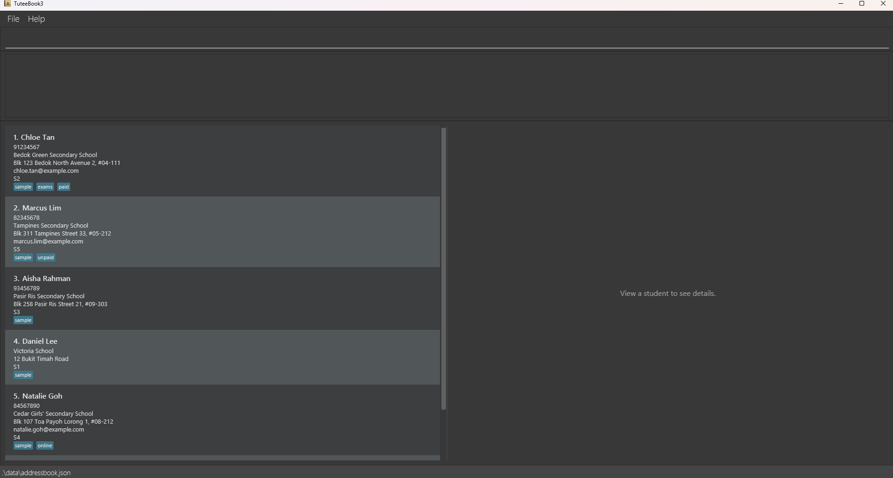
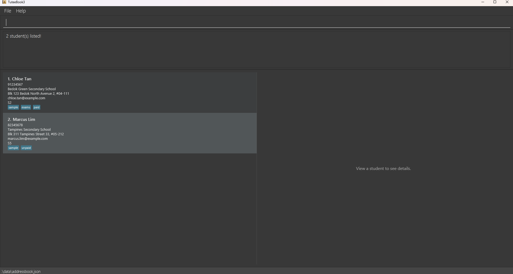

TuteeBook3 is a **desktop app for private tutors who teach secondary school students (S1 to S5) in Singapore**. It keeps each student's contact details, guardian contact, school, level, subjects and bands, and lesson notes in one place, so you can pull up a student's full record quickly, such as when a guardian calls or just before a lesson.

TuteeBook3 is **optimized for fast typists**. You do almost everything by typing short commands in a Command Line Interface (CLI), and a Graphical User Interface (GUI) shows the results, so you can manage your students faster than with a mouse-driven app or a notebook.

* Table of Contents
{:toc}

--------------------------------------------------------------------------------------------------------------------

## Quick start

1. Make sure Java `25` is installed. To check, open a terminal and run `java -version`. The version shown should start with `25`, such as `openjdk version "25.0.1"`. If it doesn't, install Java 25 using the [Java installation guide](https://se-education.org/guides/tutorials/javaInstallation.html) for your operating system.<br>
   **Mac users:** install the exact JDK named in the [Java installation guide for Mac](https://se-education.org/guides/tutorials/javaInstallationMac.html).

1. Download the latest `.jar` file from the [TuteeBook3 releases page](https://github.com/AY2627S1-CS2103T-T09-1/tp/releases).

1. Copy the file to the folder you want to use as the _home folder_ for TuteeBook3.

1. Open a terminal, `cd` to the folder containing the JAR file, and run `java -jar TuteeBook3.jar`.<br>
   A GUI similar to the one below should appear in a few seconds. Note how the app contains some sample data.<br>
   

1. Familiarize yourself with TuteeBook3 by trying its commands using the sample data. Type a command in the command box and press Enter to execute it. For example, type **`help`** and press Enter to show the available commands in the result display.<br>
   Some other commands you can try:

   * `list` : Lists all students.

   * `view 1` : Shows the full record of the 1st student in the list.

   * `add n/John Doe p/98765432 sch/Victoria School lvl/S3 sub/Mathematics band/G1` : Adds a student named `John Doe`, who is in S3 at Victoria School and takes Mathematics at G1.

   * `delete 3` : Deletes the 3rd student shown in the current list.

   * `clear` : Asks you to confirm before deleting all students and their notes.

   * `exit` : Exits the app.

1. When you finish trying the commands and before you enter your own student records, type `clear`, then enter `CONFIRM` to remove all sample students. Each sample student has the tag `sample`, so `filter t/sample` lists them. Alternatively, type `clear -f` to remove them immediately without confirmation. Both methods remove every student and note currently stored.

1. Refer to [How commands are written](#how-commands-are-written) to learn how to type commands, then the [Features](#features) section for details of each command.

--------------------------------------------------------------------------------------------------------------------

## How commands are written

You run TuteeBook3 by typing a command in the command box and pressing Enter. Most commands look like this:

```
edit 2 p/91234567 sub/Mathematics band/G2
│    │ │ │        └──────────┬──────────┘
│    │ │ │                   └ a subject and its band, always together
│    │ │ └ value
│    │ └ prefix
│    └ INDEX of the student in the list on screen
└ command word
```

* **Command word**: what to do, such as `add`, `edit`, or `filter`. It is not case-sensitive, so `ADD` and `Add` work the same as `add`.
* **INDEX**: which student, using the number shown beside them in the student list. It changes when the list changes, such as after `filter`.
* **Prefix**: a short label ending in `/`, such as `p/` for phone. It tells TuteeBook3 what the value after it is.
* **Value**: what you type after a prefix, such as `91234567`.

**Prefixes are case-sensitive and must be written as shown. Put a space before every prefix.** Without a space,
TuteeBook3 reads the prefix as part of the value before it:

You type | TuteeBook3 reads
---------|-----------------
`add n/John Doe p/98765432 ...` | name `John Doe`, phone `98765432`
`add n/John Doep/98765432 ...` | name `John Doep/98765432`, which is not a valid name

When a value that cannot contain `/` contains one, the error also asks you to check that each prefix is one the
command accepts and has a space before it. For addresses, which can contain `/`, TuteeBook3 checks whether a known
prefix and a valid value for that field appear immediately after a slash. If they do, it reports the missing space
instead of saving or searching the joined text as part of the address.

In `add`, if a required prefix (`n/`, `sch/`, `lvl/`, or `sub/`) is joined to the value before it, the error may
instead say that the parameter is missing. In `edit`, a joined `sub/` may produce the missing `sub/` error when
`band/` is present.

For example, `a/Blk 1/2` remains a valid address. But `a/Blk 1/2P/91234567` produces a red error explaining that
`P/` is case-sensitive, and that to start the `p/` parameter you write `p/` with a space before it.
`a/Blk 1/2p/91234567` produces a red error explaining that to start the `p/` parameter you put a space before it. Write `a/Blk 1/2 p/91234567` to give both values correctly. The same check
applies to `add`, `edit`, and `filter a/...`.

This check uses the text after the candidate prefix to avoid rejecting ordinary address slashes. It can still mistake a slash for a joined prefix when the word before the slash ends in a prefix's letters and the text after it is a valid value for that field. For example, `a/Ang Mo Kio Town/Central` is read as `Tow` followed by `n/Central`, and `a/Jurong East/West` as `Eas` followed by `t/West`. To keep such a slash in the address, put a space before it, as in `a/Ang Mo Kio Town /Central`. The error message suggests this too.

### Confirming a command

Some commands ask you to confirm before they go ahead:

* `delete`, `deletenote`, and `clear`, before they delete anything.
* `add` and `edit`, when another student already has the same name. See [Duplicate students](#duplicate-students).

The command shows a confirmation prompt that says what will happen. The next line tells you how to go ahead, such as `Type CONFIRM (uppercase) to delete this student and all their notes.`

* To go ahead, type `CONFIRM` in uppercase and press Enter. Spaces before or after it are ignored.
* Any other non-blank input, including `confirm` or a mistyped command, cancels the request. TuteeBook3 then runs what you typed as a normal command, with the red notice `The earlier 'delete' command has been cancelled.` (or the name of the command you cancelled) above its result.
* Only one command waits for confirmation at a time. If you type the same command again with the same values, it replaces the waiting one and no notice appears. If you type that same command with `-f` (only `clear`, `delete`, and `deletenote` accept `-f`), it runs right away and no notice appears. For example, while `delete 1` is waiting, `delete -f 1` deletes the 1st student immediately, but `delete -f 2` shows the notice.
* Pressing Enter when the command box is empty or holds only spaces does nothing. The request stays open.
* Until you confirm, nothing changes. The student list and the student record on the right stay as they are.
* If no command is waiting for confirmation, for example because you already cancelled it, `CONFIRM` shows `There is no command waiting for confirmation. Nothing was changed.`

**Skipping confirmation with `-f`.** To skip the prompt for `delete`, `deletenote`, or `clear`, put `-f` straight after the command word. For example, `delete -f 2` deletes the 2nd student immediately. `add` and `edit` have no `-f`.

### Reading a command format

Each command below has a format line, such as:

`add n/NAME [p/PHONE] sch/SCHOOL ... sub/SUBJECT band/BAND [sub/SUBJECT band/BAND]... [t/TAG]...`

You see | It means | For example
--------|----------|------------
`UPPER_CASE` | Replace it with your own value | `n/NAME` → `n/John Doe`
No brackets | Required | `sch/SCHOOL` must be given
`[ ]` | Optional | `[p/PHONE]` can be left out
`...` | Can be given more than once, or not at all if it's in `[ ]` | `[t/TAG]...` → `t/paid t/exams`

The command box holds one line. In text pasted from web pages, documents, or chat apps, TuteeBook3 reads line breaks, tabs, and special spaces, such as a non-breaking space, as normal spaces, and removes invisible characters, such as a zero-width space. It also saves curly quotes (`‘`, `’`, `“`, and `”`) as straight quotes (`'` and `"`), and en and em dashes (`–` and `—`) as hyphens (`-`).

<div markdown="span" class="alert alert-warning">:exclamation: **Caution:**
Type commands on your keyboard rather than pasting them where you can. Some pasted characters only look like keyboard symbols. For example, a full-width slash (`／`) does not start a parameter, so `n／John Doe` is not read as a name. Some PDF viewers also drop the spaces around line breaks when you copy, so check a pasted command before you press Enter.
</div>

--------------------------------------------------------------------------------------------------------------------

## Features

### Parameter details

These are the values you type in commands. The table below covers the student details you can give in `add` and `edit`. Each one is entered after its prefix, such as `n/` for `NAME`. [Indexes and notes](#indexes-and-notes) covers the values that pick a student or a note.

Parameters can be given in any order, except that each `sub/SUBJECT` must be immediately followed by its `band/BAND`. For example, `sub/Mathematics band/G1 lvl/S3` is valid, but `sub/Mathematics lvl/S3 band/G1` is not.

The rules below use the terms **English letter**, **digit**, and **keyboard symbol**, as defined in the [Glossary](#glossary).

Parameter | Prefix | Required in `add` | Rules | Examples
----------|--------|-------------------|-------|--------
`NAME` | `n/` | Yes | English letters, digits, and spaces only. Accented letters and punctuation aren't supported. | ✓ `Rajesh so Kumar`<br>✗ `Zoë Lim`<br>✗ `Rajesh s/o Kumar`
`PHONE` | `p/` | No | 3 to 15 digits, with an optional `+` at the start. See [Phone numbers](#phone-numbers). | ✓ `9123 4567`<br>✗ `12`
`SCHOOL` | `sch/` | Yes | 1 to 100 characters, with at least one English letter. Also allows digits, spaces, periods (`.`), apostrophes (`'` or `’`), ampersands (`&`), parentheses, commas, and hyphens (`-`). Accented letters and other punctuation aren't supported. | ✓ `Victoria School`<br>✓ `St. Joseph's Institution`<br>✓ `Anglo-Chinese School (Independent)`<br>✓ `School of Science and Technology, Singapore`<br>✗ `École Française`<br>✗ `School/Name`
`ADDRESS` | `a/` | No | Up to 200 characters, using the same characters as a note's `TEXT`: English letters, digits, spaces, keyboard symbols such as `# / , - ( ) '`, and the curly apostrophe `’`. | ✓ `Blk 123 Bedok North Avenue 2, #04-111`<br>✗ `Rue de l'Église 5`<br>✗ more than 200 characters
`EMAIL` | `e/` | No | Up to 254 characters, in the form `local-part@domain`. See [Emails](#emails). | ✓ `chloe.tan@example.com`<br>✗ `chloe.tan@`
`LEVEL` | `lvl/` | Yes | `S1` to `S5`. Uppercase or lowercase both work. | ✓ `S3`, `s3`<br>✗ `S6`
`SUBJECT` | `sub/` | Yes, 1 to 8 | 1 to 40 characters: English letters, spaces, hyphens, parentheses, commas, and ampersands, with at least one letter. A subject can't appear twice, ignoring case and extra spaces. See [Subjects and bands](#subjects-and-bands). | ✓ `Mathematics`<br>✓ `Science (Physics, Chemistry)`<br>✓ `Design & Technology`<br>✗ `Maths 2`<br>✗ `Français`
`BAND` | `band/` | Yes, after each `sub/` | `G1`, `G2`, or `G3`. Uppercase or lowercase both work, and it is shown in uppercase. Must come right after its `sub/`. | ✓ `G1`, `g1`<br>✗ `G4`
`GUARDIAN_NAME` | `gn/` | No, but give both `gn/` and `gp/` or neither | Same rules as `NAME`. | ✓ `Mary Tan`<br>✗ `Zoë Tan`<br>✗ `Mary-Ann Tan`
`GUARDIAN_PHONE` | `gp/` | No, but give both `gn/` and `gp/` or neither | Same rules as `PHONE`. | ✓ `91234567`<br>✗ `12`
`TAG` | `t/` | No, any number | One word of 1 to 30 English letters or digits. Single hyphens may join parts of the word. A student can't have the same tag twice, ignoring case. See [Tags](#tags). | ✓ `O-level`<br>✗ `O level`

<div markdown="block" class="alert alert-primary">

:bulb: **Tip:**

* When you add or edit a student, spaces at the start and end of each value are removed, and repeated ordinary spaces are collapsed to one. Capitalization is kept as you typed it. For example, `n/John  Doe` is saved as `John Doe`.
* If you leave out an optional field, the student list hides it and the student detail view shows an em dash (`—`).

</div>

Names accept English letters, digits, and spaces only. School names also accept periods, apostrophes, ampersands, parentheses, commas, and hyphens, but must contain at least one English letter. Both fields reject accented letters and letters from other alphabets.

Addresses accept the same characters as notes.

#### Phone numbers

The phone number is optional, since younger students may not have their own phone. `PHONE` and `GUARDIAN_PHONE` follow the same rules.

* You can type spaces or hyphens (`-`), such as `9123 4567` or `9123-4567`. They are removed when the number is saved. En and em dashes (`–` and `—`) are read as hyphens. Other dashes, such as the minus sign (`−`), are not allowed.
* A Singapore number (8 digits starting with 6, 8, or 9) is saved as those 8 digits. A leading `+65` is removed, so `+65 9123 4567` is saved as `91234567`. If what follows `+65` isn't a Singapore number, the `+65` is kept.
* For an overseas number, type `+` and the country code, such as `+60 12-345 6789`. For Singapore, type `+65`, not `65`.
* If a number doesn't look like a Singapore number, TuteeBook3 still saves it but shows a warning that names the field, such as `Warning: guardian phone +60123456789 doesn't look like a Singapore number (8 digits starting with 6, 8, or 9, with or without +65). Use edit to fix it if it's wrong.`
* If a number can't be saved, the error message says why, such as `Phone 12 needs 3 to 15 digits, counting the country code, but has 2.` or `Phone 9123.4567 contains ".", which isn't allowed. Use only digits, spaces, hyphens (-), and a + at the start.` Messages for the guardian's number start with `Guardian phone`.

#### Emails

An email has the form `local-part@domain`, such as `chloe.tan@example.com`: exactly one `@`, with a local part before it and a domain after it. Spaces before and after the email are removed, but an email with a space inside it is rejected. The 254-character limit is the longest address that email servers accept.

* The local part can contain English letters, digits, and the symbols `+`, `_`, `.`, and `-`. It cannot start or end with a symbol or have two symbols in a row, so `chloe..tan@example.com` and `chloe.-tan@example.com` are rejected.
* The domain is made up of labels separated by single periods. Each label starts and ends with an English letter or digit and can contain single hyphens, such as `my-school`. The last label has at least 2 letters or digits in a row, such as `com`.
* If the domain has no period, such as `john@gmail`, TuteeBook3 still saves the email but shows a warning, since an ending such as `.com` may be missing: `Warning: email john@gmail has no "." after the "@", so an ending such as ".com" may be missing. Use edit to fix it if it's wrong.`

<div markdown="span" class="alert alert-info">:information_source: **Note:**
Each student and guardian has one phone number, which is the number you use to reach them. TuteeBook3 does not support a second phone number or a guardian email address. To keep one, add it as a note on that student with `addnote`, for example `addnote 1 note/Mum's office: 6123 4567`.
</div>

#### Subjects and bands

Each student takes 1 to 8 subjects. A subject name can contain English letters, spaces, hyphens, parentheses, commas, and ampersands. It must be 1 to 40 characters long and contain at least one letter. For example, `Science (Physics, Chemistry)`, `Design & Technology`, and `Food & Consumer Education` are valid names. Digits, slashes, and other symbols are not allowed. Like names and school names, subject names reject accented letters and letters from other alphabets, so type `French` rather than `Français`.

Give each subject with `sub/`, followed immediately by its band with `band/`, such as `sub/Science (Physics, Chemistry) band/G3 sub/English band/G3`.

* A subject can't be given twice, even with different bands. Capitalization and extra spaces are ignored, so `Additional Mathematics` and `additional  mathematics` are the same subject.
* In `edit`, giving subject-band pairs replaces all of the student's subjects. Leaving out `sub/` keeps them. An empty `sub/` doesn't remove subjects, since every student needs at least one.

If the subjects or bands are wrong, `add` and `edit` show one of these messages:

| Problem | Message |
| --- | --- |
| Neither `sub/` nor `band/` in `add` | `Missing required parameters: sub/, band/.` Any other missing parameters are listed too, such as `Missing required parameters: lvl/, sub/, band/.` |
| `band/` but no `sub/` anywhere in `add`, or `band/` supplied alone in `edit` | `Missing required parameter: sub/.` |
| Missing, misplaced, or repeated `band/` within a pair | `Each sub/ must be immediately followed by one band/.` |
| Empty band or a value other than G1, G2, or G3 | `Band must be one of G1, G2, G3.` |
| Invalid subject name | `Subjects must be 1-40 characters, contain at least one English letter (A-Z), and use only English letters, spaces, hyphens (-), parentheses, commas, and ampersands (&).` |
| More than eight subject-band pairs | `A student may have at most 8 subjects.` |
| Repeated subject name | `Subject is repeated: SUBJECT.` |

For example, `edit 1 sub/Mathematics band/G1 sub/mathematics band/G2` fails with `Subject is repeated: mathematics.`

#### Tags

To give more than one tag, put `t/` before each one, such as `t/exams t/paid`. Tags keep the capitalization you enter and are shown in the order you typed them.

<div markdown="span" class="alert alert-primary">:bulb: **Tip:**
Use tags for things you want to see at a glance, such as payment status or exam preparation. Tags are matched exactly apart from capitalization, so `exam-prep` and `examprep` are different tags. Pick one spelling and keep to it. For longer details, use a note instead.
</div>

#### Indexes and notes

These values pick a student or a note, or give a note's text.

Parameter | Prefix | Used in | Rules | Example
----------|--------|---------|-------|--------
`INDEX` | none, comes straight after the command word | `view`, `edit`, `delete`, `addnote`, `editnote`, `deletenote` | The number shown beside the student in the student list, or at the top of the student detail view. A positive integer no greater than the largest index in the student list. For example, if the list shows 1 to 3, you can use 1, 2, or 3. | `2`
`NID` | `nid/` | `editnote`, `deletenote` | The number shown before the note in the student detail view. A positive integer. Use `view INDEX` to see a student's notes and their NIDs. | `1`
`TEXT` | `note/` | `addnote`, `editnote`, `filter` | 1 to 500 characters, counting spaces between words. Use English letters, digits, spaces, and keyboard symbols, such as `/ % : ( ) - ' " ^ +`. The curly apostrophe `’` is also allowed, as in school names. Other characters, such as accented letters and emoji, are not allowed. Spaces before and after the text are removed. Pasted line breaks and tabs become spaces, as described in [Reading a command format](#reading-a-command-format). | `WA2 Math: 36/50`

* `INDEX` and `NID` can change. An index changes when the list changes, such as after `filter` or `delete`. After a note is deleted, the notes after it move up one number. Check the list or the student detail view before you use them.
* After `view`, the student's `INDEX` is also shown at the top of the student detail view, so you can use it in `edit`, `delete`, `addnote`, `editnote`, and `deletenote` without looking for the student in the list.
* Everything after `note/` is the note text, so `TEXT` can contain other prefixes, such as `t/f` or another `note/`. For example, `addnote 1 note/Revise t/f questions` adds the note `Revise t/f questions`.
* Notes saved by an earlier version may contain characters that notes no longer allow. See [Upgrading from an earlier version](#upgrading-from-an-earlier-version).

### Managing students

These commands add students, edit their details, and remove them.

#### Adding a student: `add`

Adds a student to TuteeBook3.

Format: `add n/NAME [p/PHONE] sch/SCHOOL [a/ADDRESS] [e/EMAIL] lvl/LEVEL sub/SUBJECT band/BAND [sub/SUBJECT band/BAND]... [gn/GUARDIAN_NAME gp/GUARDIAN_PHONE] [t/TAG]...`

* Each parameter follows the rules in [Parameter details](#parameter-details).
* After the student is added, the full list is shown on the left and the new student's record is shown on the right.
* A new student has no notes. Use `addnote` to add them.

Examples:

To add a student with… | Type
-----------------------|-----
Only the required details | `add n/Tim Tan sch/Victoria School lvl/S2 sub/Mathematics band/G1`
Two subjects at different bands | `add n/Sarah Wong sch/Bedok Green Secondary School lvl/S2 sub/Mathematics band/G1 sub/English band/G3`
A guardian (use `view INDEX` to see the guardian's details) | `add n/Jun Wei Lim sch/Victoria School lvl/S2 sub/Mathematics band/G1 gn/Mary Lim gp/91234567`
A guardian with an overseas number (saved as `+60123456789`, with a warning that it doesn't look like a Singapore number) | `add n/Nurul Rahman sch/Victoria School lvl/S2 sub/Mathematics band/G1 gn/Farah Rahman gp/+60 12-345 6789`
Every detail | `add n/James Ho p/62224444 sch/Victoria School a/Blk 123 Bedok North Avenue 2, #04-111 e/james.ho@example.com lvl/S2 sub/Mathematics band/G1 sub/English band/G2 gn/Mary Ho gp/91234567 t/paid`

##### Errors in `add`

If the command has a mistake, `add` shows a red error and doesn't add the student. If there is more than one mistake, only the first one is shown. `add` checks for mistakes in this order:

1. Text between `add` and the first parameter
1. Missing parameters
1. Repeated parameters
1. Invalid values, in the order `NAME`, `PHONE`, `SCHOOL`, `ADDRESS`, `EMAIL`, `LEVEL`, subjects, guardian, and tags

Problem | Message
--------|--------
There are no parameters, or there is text before the first one, such as `add John Doe sch/Victoria School ...` | `Invalid command format!` followed by how to use `add`
`n/`, `sch/`, `lvl/`, or `sub/` is missing, or has no space before it | `Missing required parameters: sch/, lvl/.`, naming every missing one. A missing `sub/` is named together with `band/`, as in `Missing required parameters: sub/, band/.`
`n/`, `p/`, `sch/`, `a/`, `e/`, `lvl/`, `gn/`, or `gp/` is given more than once | `Multiple values specified for the following single-valued field(s): p/`
`NAME` is invalid | `Names must start with an English letter (A-Z) or digit (0-9) and use only English letters, digits, and spaces.`
`PHONE` or `GUARDIAN_PHONE` is invalid | A message saying why. See [Phone numbers](#phone-numbers).
`sch/` has no value or only spaces | `School name cannot be blank.`
`SCHOOL` is longer than 100 characters | `School name must be at most 100 characters; this value has 101.`, with the actual character count
`SCHOOL` contains an unsupported character | A message naming the school and first unsupported character, and listing the allowed characters. For example, `School name "School#1" contains "#", which isn't allowed. Use English letters, digits, spaces, periods (.), apostrophes (' or ’), ampersands (&), parentheses, commas, and hyphens (-).`
`SCHOOL` contains only digits and allowed punctuation | `School name "123" must contain at least one English letter (A-Z).`
`ADDRESS` is blank or longer than 200 characters | `Addresses must not be blank and must be at most 200 characters.`
`ADDRESS` contains a character that isn't allowed, such as `É` or an emoji | `Address contains "É", which isn't allowed. Use only English letters, digits, spaces, and keyboard symbols.`, with the first such character in `ADDRESS`
`EMAIL` is invalid or longer than 254 characters | A message saying what is wrong, such as `Email "john@" has no domain after the "@", such as example.com.`
`LEVEL` is not `S1` to `S5` | `Level must be one of S1, S2, S3, S4, S5.`
A subject or band is wrong | See [Subjects and bands](#subjects-and-bands)
Only one of `gn/` and `gp/` is given | `Guardian name (gn/) and guardian phone (gp/) must be given together.`
`TAG` contains a space, such as `t/exam prep` | A message starting with `Tag "exam prep" contains a space.`
`TAG` is blank, too long, or has a symbol other than a single hyphen | A message starting with `Tags must be one word of 1-30 English letters (A-Z) or digits (0-9).`
The same tag is given twice, ignoring case, such as `t/Paid t/paid` | `Tag "paid" is given more than once.`

##### Duplicate students

After all the input is valid, `add` checks whether the new student might already be recorded. It compares only the name, school, and level.

Another student has… | What happens
---------------------|-------------
The same name, but a different school or level | A confirmation prompt, such as `Student not added yet: NAME is also recorded at SCHOOL (LEVEL).` If several students match, their school and level details are separated by `; `. Type `CONFIRM` to add the student anyway. See [Confirming a command](#confirming-a-command).
The same name, school, and level | A red error: `A student named NAME at SCHOOL, level LEVEL already exists. If this is a different student, enter a distinguishing name, for example Chloe Tan 2.` The student is not added.

* Names and schools are compared ignoring capitalization and extra spaces. Levels are compared directly.
* Two students with the same name, school, and level would look identical in the app, so you couldn't tell whose record you are viewing or changing. If they are different people, give one a distinguishing name, such as `Chloe Tan 2`.
* The check can't catch every real duplicate. For example, `Chloe Tan` and `Chloe Tan Mei Ling` count as different names.

#### Editing a student: `edit`

Changes the details of an existing student.

Format: `edit INDEX [n/NAME] [p/PHONE] [sch/SCHOOL] [a/ADDRESS] [e/EMAIL] [lvl/LEVEL] [sub/SUBJECT band/BAND]... [gn/GUARDIAN_NAME] [gp/GUARDIAN_PHONE] [t/TAG]...`

* `INDEX` follows the rules in [Indexes and notes](#indexes-and-notes). Every other parameter follows the rules in [Parameter details](#parameter-details).
* Give at least one parameter. Each one you give replaces the student's current value. Anything you leave out stays as it is, and the student's notes are kept.
* Every student must have a school. `edit INDEX sch/` with no school value is rejected; it cannot remove the school.
* Tags and subjects are replaced as a whole. `t/paid` replaces all of the student's tags with `paid`, and `sub/English band/G2` replaces all of their subjects with English at G2. Include every tag and subject you want to keep. See [Subjects and bands](#subjects-and-bands).
* The warning that a phone number doesn't look like a Singapore number only appears when you type `p/` or `gp/` in that command. Likewise, the warning about an email with no period in its domain only appears when you type `e/`.
* The displayed list stays in place, and the edited student's record opens on the right. Fields shown on the list card are updated immediately. If the edited student no longer matches your last `filter`, they stay in the list until you enter `list` or `filter` again. The result display tells you when an edit makes a student stop matching.

To remove a detail, type its prefix with no value, or for a subject, give the subjects to keep:

To remove… | Type
-----------|-----
The phone number | `p/`
The address | `a/`
The email | `e/`
All tags | `t/`
One subject, such as Science from a student taking Mathematics, English, and Science | `sub/` for each subject to keep, with its band, such as `sub/Mathematics band/G2 sub/English band/G3`. Use `view INDEX` to check the bands first.
The guardian | `gn/ gp/`, with both empty. Leaving only one empty, such as `gn/` alone or `gn/ gp/91234567`, is rejected so that the guardian isn't removed by mistake.

The name, school, and level can't be removed, and a student must keep at least one subject.

To change the guardian:

* If the student already has a guardian, `gn/` or `gp/` on its own changes just that part of the guardian.
* If the student has no guardian yet, give both `gn/` and `gp/` to add one.

Examples:

To… | Type
----|-----
Change the phone number and school of the 1st student | `edit 1 p/91234567 sch/Victoria School`
Replace the subjects with Mathematics at G2 and English at G3 | `edit 1 sub/Mathematics band/G2 sub/English band/G3`
Replace the tags with `paid` and `exams` | `edit 1 t/paid t/exams`
Change only the guardian's phone number | `edit 1 gp/98765432`
Remove the phone number of the 3rd student | `edit 3 p/`
Remove the guardian | `edit 1 gn/ gp/`

##### Errors in `edit`

If the command is wrong, `edit` shows one of these messages and does not change the student.

Problem | Message
--------|--------
`INDEX` is zero, negative, too large to use, or larger than the number of students shown, such as `0`, `-1`, or `99999999999` | `Index must be a positive integer shown in the displayed student list.`
`INDEX` is missing or is not an integer, or there is text between `INDEX` and the first parameter | `Invalid command format!` followed by how to use `edit`
No field to edit is given, such as `edit 1` | `At least one field to edit must be provided.`
`n/`, `p/`, `sch/`, `a/`, `e/`, `lvl/`, `gn/`, or `gp/` appears more than once, such as `edit 1 n/Amy n/Ben` | `Multiple values specified for the following single-valued field(s): n/`
A value is invalid | The same message as in [Errors in `add`](#errors-in-add)
A subject or band is wrong | See [Subjects and bands](#subjects-and-bands)
Only one of `gn/` and `gp/` is empty, such as `edit 1 gn/` | `Guardian name (gn/) and guardian phone (gp/) cannot be empty. To remove the guardian, use gn/ gp/ with no values.`
The student has no guardian, and only one of `gn/` and `gp/` is given | `This student has no guardian yet. Give both gn/ and gp/ to add one.`
`gn/ gp/` is given for a student with no guardian | `This student has no guardian to remove.`
Every value given is the same as the student's current value, such as `edit 1 n/Chloe Tan` for a student already named Chloe Tan, or `edit 1 p/` for a student with no phone | `No changes made: NAME at SCHOOL (LEVEL) already has these details.` in amber. The student stays as they are, and their record opens on the right. Changing only uppercase and lowercase letters, such as `chloe tan` to `Chloe Tan`, counts as a change.

##### Duplicate students in `edit`

`edit` checks the student's new details against the other students, the same way as [`add`](#duplicate-students). The student being edited is not compared with themselves, and the confirmation prompt only appears when you change the name, school, or level.

Another student has… | What happens
---------------------|-------------
The same name, but a different school or level | A confirmation prompt, such as `Edit not saved yet: NAME is also recorded at SCHOOL (LEVEL).` If several students match, their school and level details are separated by `; `. Type `CONFIRM` to save the edit anyway. See [Confirming a command](#confirming-a-command).
The same name, school, and level | A red error: `Another student named NAME at SCHOOL, level LEVEL already exists. If these are different students, edit the name to include an identifier, for example Chloe Tan 2.` The student is not changed.

#### Deleting a student: `delete`

Deletes a student, together with their guardian details and all of their notes.

Format: `delete [-f] INDEX`

* `INDEX` follows the rules in [Indexes and notes](#indexes-and-notes).
* `delete` asks you to confirm first, with the prompt `This will delete NAME at SCHOOL (LEVEL) and all their notes.` See [Confirming a command](#confirming-a-command). Use `delete -f INDEX` to delete immediately.
* After a student is deleted, the current filter remains active while it still has matches. The index numbers of the remaining matching students may change, so check the list before you run another command that uses an index.
* If you delete the filter's last matching student while other students remain, TuteeBook3 shows the full list and adds `The filtered list is now empty, so all remaining students are shown.` to the result.
* After deletion, the student detail view returns to `View a student to see details.`

<div markdown="span" class="alert alert-warning">:exclamation: **Caution:**
You cannot undo `delete`. Check `INDEX` in the student list before you confirm.
</div>

Examples:

To… | Type
----|-----
Delete the 2nd student in the full student list | `list`, then `delete 2`
Delete the 1st student in the search results | `filter n/Tan`, then `delete 1`
Delete the 3rd student without confirming | `delete -f 3`

##### Errors in `delete`

If the command is wrong, `delete` shows one of these messages and does not delete any student.

Problem | Message
--------|--------
`INDEX` is zero, negative, too large to use, or larger than the number of students shown, such as `0`, `-1`, or `99999999999` | `Index must be a positive integer shown in the displayed student list.`
`INDEX` is missing or is not an integer, such as `abc` | `Invalid format. Usage: delete [-f] INDEX`
There is more than one value, such as `delete 1 2` | `Invalid format. Usage: delete [-f] INDEX`

### Managing notes

Each student has a numbered list of notes, shown in the student detail view.

#### Adding a note to a student: `addnote`

Adds a note to the end of a student's notes.

Format: `addnote INDEX note/TEXT`

* `INDEX` and `TEXT` follow the rules in [Indexes and notes](#indexes-and-notes).
* You can add the same note text more than once.
* New notes appear in the student detail view after the existing notes.
* Notes are numbered in the order you added them, such as `1. Weak in algebra`.
* Adding a note does not change which students are shown.
* After the note is added, the student's updated record opens on the right.
* If you edit the data file, each note must follow the same `TEXT` rules. Otherwise, the app starts with an empty student list.

Examples:

To… | Type
----|-----
Add the note `Weak in algebra` to the 1st student in the displayed list | `addnote 1 note/Weak in algebra`
Add a note to the student shown by `view 2` | `view 2`, then `addnote 2 note/WA2 Math: 36/50`

##### Errors in `addnote`

If the command is wrong, `addnote` shows one of these messages and does not change any student. If `INDEX` is zero, negative, or too large, `addnote` reports that first, even if `TEXT` is also wrong.

Problem | Message
--------|--------
`INDEX` is zero, negative, too large to use, or larger than the number of students shown, such as `0`, `-1`, or `99999999999` | `Index must be a positive integer shown in the displayed student list.`
`TEXT` is empty or only spaces | `Note text cannot be blank.`
`TEXT` contains a character that isn't allowed, such as `é` or an emoji | `Note text contains "é", which isn't allowed. Use only English letters, digits, spaces, and keyboard symbols.`, with the first such character in `TEXT`
`TEXT` is longer than 500 characters | `Note text must be at most 500 characters.`
`INDEX` or `note/TEXT` is missing, or there is no space before `note/` | `Invalid command format!` followed by how to use `addnote`
`INDEX` is not an integer, such as `abc`, or there is other text between `INDEX` and `note/`, such as `addnote 1 nid/1 note/hi` or `addnote 1 t/x note/hi` | `Invalid command format!` followed by how to use `addnote`

#### Editing a note of a student: `editnote`

Replaces the text of one of a student's notes.

Format: `editnote INDEX nid/NID note/TEXT`

* `INDEX`, `NID`, and `TEXT` follow the rules in [Indexes and notes](#indexes-and-notes). `TEXT` is the new text of the note.
* `nid/NID` must come before `note/TEXT`. Everything after `note/` is the note text, so `TEXT` can contain anything, including `t/f`, `nid/`, or another `note/`. For example, `editnote 1 nid/2 note/Revise t/f questions` saves the note `Revise t/f questions`.
* The edited note keeps its NID, and the student's other notes do not change.
* If the new text is the same as the current text, the note stays as it is and `editnote` shows the message `No changes made: note NID of NAME at SCHOOL (LEVEL) already says: TEXT` in amber. Changing only uppercase and lowercase letters, such as `algebra` to `Algebra`, counts as a change.
* Editing a note does not change which students are shown.
* After the note is edited, the student's updated record opens on the right. If the text is unchanged, the same record opens with the warning.

Examples:

To… | Type
----|-----
Replace note 2 of the 1st student in the displayed list with `Improving in algebra` | `editnote 1 nid/2 note/Improving in algebra`
Replace the first note of the student shown by `view 3` | `view 3`, then `editnote 3 nid/1 note/WA2 Math: 42/50`

##### Errors in `editnote`

If the command is wrong, `editnote` shows one of these messages and does not change any student. When several parts are wrong, `editnote` reports the first one in this table.

Problem | Message
--------|--------
`nid/NID` comes after `note/TEXT`, such as `editnote 1 note/hi nid/2` | `Put nid/NID before note/TEXT. Everything after note/ is read as the note text.`
`INDEX`, `nid/NID`, or `note/TEXT` is missing, or there is no space before `nid/` or `note/` | `Invalid command format!` followed by how to use `editnote`
`INDEX` is not an integer, such as `abc`, or there is text between `INDEX` and the first prefix, such as `editnote 1 abc nid/2 note/hi` | `Invalid command format!` followed by how to use `editnote`
`INDEX` is zero, negative, too large to use, or larger than the number of students shown, such as `0`, `-1`, or `99999999999` | `Index must be a positive integer shown in the displayed student list.`
`nid/` appears more than once before `note/` | `Multiple values specified for the following single-valued field(s): nid/`
`NID` is empty or is not a positive integer, such as `0`, `-1`, or `abc` | `NID must be a positive integer.`
`TEXT` is empty or only spaces | `Note text cannot be blank.`
`TEXT` contains a character that isn't allowed, such as `é` or an emoji | `Note text contains "é", which isn't allowed. Use only English letters, digits, spaces, and keyboard symbols.`, with the first such character in `TEXT`
`TEXT` is longer than 500 characters | `Note text must be at most 500 characters.`
The student has no notes | `NAME at SCHOOL (LEVEL) has no notes to edit.`
`NID` is larger than the number of notes the student has | `NID 5 does not exist. NAME at SCHOOL (LEVEL) has only 3 notes.`, with the NID you typed and the number of notes the student has (`1 note` if they have one)

#### Deleting a note from a student: `deletenote`

Deletes one note from a student's notes.

Format: `deletenote [-f] INDEX nid/NID`

* `INDEX` and `NID` follow the rules in [Indexes and notes](#indexes-and-notes).
* `deletenote` asks you to confirm first, with the prompt `This will delete note NID from NAME at SCHOOL (LEVEL).` See [Confirming a command](#confirming-a-command). Use `deletenote -f INDEX nid/NID` to delete immediately.
* After you delete a note, the notes after it move up one number. For example, if a student has 3 notes and you delete note 2, the old note 3 becomes note 2. Check the student detail view for the new numbers before you delete another note.
* Deleting a note does not change which students are shown.
* After the deletion is confirmed, or when you use `-f`, the student's updated record opens on the right.

<div markdown="span" class="alert alert-warning">:exclamation: **Caution:**
You cannot undo `deletenote`. Check `INDEX` and `NID` in the student detail view before you confirm.
</div>

Examples:

To… | Type
----|-----
Delete note 2 of the 1st student in the displayed list | `deletenote 1 nid/2`
Delete the first note of the student shown by `view 3` | `view 3`, then `deletenote 3 nid/1`
Delete note 1 of the 2nd student without confirming | `deletenote -f 2 nid/1`

##### Errors in `deletenote`

If the command is wrong, `deletenote` shows one of these messages and does not change any student. If `INDEX` is zero, negative, or too large, `deletenote` reports that first, even if `NID` is also wrong.

Problem | Message
--------|--------
`INDEX` is zero, negative, too large to use, or larger than the number of students shown, such as `0`, `-1`, or `99999999999` | `Index must be a positive integer shown in the displayed student list.`
`INDEX` is not an integer, such as `abc`, or there is other text between `INDEX` and `nid/`, such as `deletenote 1 abc nid/2` | `Invalid command format!` followed by how to use `deletenote`
`-f` is not straight after `deletenote`, such as `deletenote 1 nid/2 -f` | `Invalid command format!` followed by how to use `deletenote`
`NID` is empty or is not a positive integer, such as `0`, `-1`, or `abc` | `NID must be a positive integer.`
The student has no notes | `NAME at SCHOOL (LEVEL) has no notes to delete.`
`NID` is larger than the number of notes the student has | `NID 5 does not exist. NAME at SCHOOL (LEVEL) has only 3 notes.`, with the NID you typed and the number of notes the student has (`1 note` if they have one)
`nid/` appears more than once | `Multiple values specified for the following single-valued field(s): nid/`
`INDEX` or `nid/NID` is missing, or there is no space before `nid/` | `Invalid command format!` followed by how to use `deletenote`

### Finding students

These commands choose which students are shown, and which student's full record is open on the right.

#### Listing all students: `list`

Shows a list of all students in TuteeBook3. Each entry shows the student's index, name, phone number (if provided), school, address (if provided), email (if provided), level, and tags (if any). The student detail view returns to `View a student to see details.` Use `view INDEX` to see the remaining details.

Format: `list`

The command does not accept additional arguments.

#### Viewing a student: `view`

TuteeBook3 shows the student list on the left and the student detail view on the right. The two halves are the same width, and you cannot resize them. The card of the student you are viewing is highlighted in the list. Cards cannot be clicked. When no student is selected, the student detail view shows `View a student to see details.` If a student's record is too long to fit, it scrolls as a whole, including the notes.

You can resize the window down to 600 pixels wide and 400 pixels tall. TuteeBook3 keeps a restored window inside the current screen if the saved size or position no longer fits. The student list and record remain usable at the minimum size by scrolling their contents.

`view` shows the full record of the student at the specified index on the right.

The student detail view contains the student's name, school, level, subject-band pairs, address, email, tags, student phone number, guardian name, and guardian phone number, followed by the student's notes. Optional fields without a recorded value, such as the address, email, tags, student phone number, or guardian details, are shown as an em dash (`—`).

Format: `view INDEX`

* `INDEX` follows the rules in [Indexes and notes](#indexes-and-notes).
* The current search results remain visible on the left while you view the student.
* Entering `view` again shows the new student in the student detail view, replacing the previous one.
* Enter `list` to return to the full student list, or `filter` to display new search results. Both commands clear the selected record and show the empty-state message on the right.
* A successful `add`, `edit`, `addnote`, `editnote`, or `deletenote` shows the affected student's record on the right. A successful `delete` or `clear` shows the empty-state message.
* Help and invalid commands leave the student record visible.

Example: `view 2` shows the full record of the second student in the currently displayed list.

##### Errors in `view`

If the command is wrong, `view` shows one of these messages and does not change the student record.

Problem | Message
--------|--------
`INDEX` is zero, negative, too large to use, or larger than the number of students shown, such as `0`, `-1`, or `99999999999` | `Index must be a positive integer shown in the displayed student list.`
`INDEX` is missing or is not an integer, or there is more than one value | `Invalid command format!` followed by how to use `view`

#### Filtering students: `filter`

Shows the students who match every filter you give.

Format: `filter [n/NAME] [sch/SCHOOL] [lvl/LEVEL] [sub/SUBJECT [band/BAND]] [p/PHONE] [e/EMAIL] [a/ADDRESS] [gn/GUARDIAN_NAME] [gp/GUARDIAN_PHONE] [t/TAG] [note/TEXT]`

* Give at least one filter.
* A student must match every filter you give. For example, `filter n/tan sch/bedok` shows students whose name contains `tan` and whose school contains `bedok`.

<div markdown="span" class="alert alert-warning">:exclamation: **Caution:**
Each filter can be given only once, including `sub/` and `t/`, even though `add` and `edit` accept several. For example, `filter n/tan n/lim`, `filter sub/Mathematics sub/Science`, and `filter t/paid t/exams` are rejected. To find students who match either value, run `filter` once for each value.
</div>

Filter | Matches students whose… | Match
-------|-------------------------|------
`n/NAME` | name contains `NAME` | partial matching
`sch/SCHOOL` | school contains `SCHOOL` | partial matching
`lvl/LEVEL` | level is `LEVEL`, one of `S1` to `S5` | exact matching
`sub/SUBJECT` | subjects include `SUBJECT` | exact matching
`sub/SUBJECT band/BAND` | subjects include `SUBJECT` at `BAND` (`G1` to `G3`) | exact matching
`p/PHONE` | own phone number is `PHONE` | exact matching
`e/EMAIL` | email contains `EMAIL` | partial matching
`a/ADDRESS` | address contains `ADDRESS` | partial matching
`gn/GUARDIAN_NAME` | guardian's name contains `GUARDIAN_NAME` | partial matching
`gp/GUARDIAN_PHONE` | guardian's phone number is `GUARDIAN_PHONE` | exact matching
`t/TAG` | tags include `TAG` | exact matching
`note/TEXT` | notes include one that contains `TEXT` | partial matching

* A filter with partial matching can match any part of the value, even part of a word. For example, `sch/vic` matches `Victoria School`.
* The `n/`, `sch/`, and `a/` filters take search text, not new student details. Search text can contain accents and punctuation. Accented letters cannot match saved names, schools, or addresses; punctuation can match a school when it is one of the supported school-name characters.
* A filter with exact matching must match the whole value. For example, `lvl/S3` matches only students in S3, `sub/math` does not match `Mathematics`, `p/9123` does not match `91234567`, and `t/paid` does not match `unpaid`.
* `band/` must come right after `sub/`, and the band must belong to that subject. For example, a student taking Mathematics at G1 and Science at G2 does not match `sub/Mathematics band/G2`.
* Phone numbers are compared the way they are saved: spaces, hyphens, and a leading `+65` are removed. For example, `p/9123 4567` and `p/+65 9123-4567` both match `91234567`. An overseas number must include its `+` and country code.
* A student without a phone never matches `p/`, a student without an email never matches `e/`, a student without an address never matches `a/`, and a student without a guardian never matches `gn/` or `gp/`.
* `note/` searches all of a student's notes. `TEXT` can be up to 500 characters, the same as a note. Like `n/` and `sch/` search text, it can contain any characters, but accented letters and emoji cannot match a saved note.
* Everything after `note/` is the note text, so put `note/` last. For example, `filter note/revise t/f` finds notes containing `revise t/f`. In `filter note/algebra lvl/S3`, `lvl/S3` is read as part of the note text, so write `filter lvl/S3 note/algebra` instead.
* A separate prefix-shaped word that `filter` does not recognize is rejected. For example, `filter n/chloe lv/S2` reports that `lv/` is not a filter prefix instead of searching for the name `chloe lv/S2`. This check does not apply inside `a/ADDRESS` or after `note/`, because addresses and notes can contain `/` as ordinary text.
* Filters are not case-sensitive, extra spaces are ignored, curly quotes (`‘`, `’`, `“`, and `”`) match straight ones (`'` and `"`), and en and em dashes (`–` and `—`) match hyphens (`-`).
* Each value is matched as one piece of text, including its spaces: `n/david lim` matches `David Lim`, but `n/lim david` does not.
* If no student matches, the student list is empty and a message tells you how to see all students again.
* Running `filter` clears the selected student record and shows `View a student to see details.` on the right.
* Enter `list` to return to the full student list.

Examples, using the sample students:

You type | TuteeBook3 shows
---------|-----------------
`filter n/c` | `Chloe Tan` and `Marcus Lim`
`filter n/lim sch/secondary` | `Marcus Lim`
`filter lvl/s2` | `Chloe Tan` and `Ethan Kumar`
`filter sub/mathematics band/G2` | `Marcus Lim` and `Daniel Lee`
`filter gp/98765432` | `Marcus Lim`, whose guardian is Grace Lim
`filter t/sample` | All six sample students
`filter note/algebra` | `Chloe Tan`
`filter lvl/S1 note/next lesson` | `Daniel Lee`

The result of `filter n/c`:



##### Errors in `filter`

If the command is wrong, `filter` shows one of these messages and does not change the student list.

Problem | Message
--------|--------
No filter is given | `Give at least one filter.` followed by how to use `filter`
There is text before the first filter | `Invalid command format!` followed by how to use `filter`
A separate word looks like a filter prefix but is not recognized, such as `lv/` or `bnd/` | `lv/ is not a filter prefix. Use n/, sch/, lvl/, sub/, band/, p/, e/, a/, gn/, gp/, t/, or note/.`, with the prefix you typed in place of `lv/`
A filter is empty, such as `sch/` | `The school to search for cannot be blank.` (or `name`, `email`, or `address`)
A filter other than `t/` appears more than once | `Each filter can be given only once, but you repeated: sub/. To see students who match either value, run filter once for each value.`, with the repeated filters listed in place of `sub/`. If `t/` is also repeated, the `t/` message is shown first.
`LEVEL` is not one of `S1` to `S5`, or is empty | `Level must be one of S1, S2, S3, S4, S5.`
`SUBJECT` is empty or invalid | `Subjects must be 1-40 characters using only English letters without accents, spaces, hyphens, parentheses, commas and ampersands, with at least one letter.`
`BAND` is not one of `G1` to `G3`, or is empty | `Band must be one of G1, G2, G3.`
`band/` is not right after `sub/`, or there is no `sub/` | `band/ must come right after sub/, such as: filter sub/Mathematics band/G2`
`PHONE` or `GUARDIAN_PHONE` is empty or not a valid phone number | The same message as `add`, such as `Phone cannot be empty.`
`TAG` contains a space | `Tag "paid exams" contains a space. filter takes one tag of one word, such as: filter t/paid`, with the tag you typed in place of `paid exams`
`t/` appears more than once | `filter takes one tag, so give t/ only once, such as: filter t/paid`
`TAG` is blank, too long, or contains a symbol other than a single hyphen between letters or digits | The same message as `add`, starting `Tags must be one word of 1-30 English letters or digits.`
`GUARDIAN_NAME` is empty | `The guardian name to search for cannot be blank.`
`NAME`, `SCHOOL`, `EMAIL`, or `GUARDIAN_NAME` contains `/`, such as `n/Chloesch/Victoria` | `No student's name can contain "/", so "Chloesch/Victoria" matches no one.` followed by `If "/" was meant to start a new parameter, check that each prefix is one this command accepts and has a space before it.`
`ADDRESS` has another filter's prefix joined to it, such as `a/tampinest/paid` | `Put a space before the "t/" prefix.`, naming the prefix you typed
`ADDRESS` has another filter's prefix in capitals, such as `a/blk N/tan` | `The "N/" prefix is case-sensitive. Use "n/" with a space before it.`, naming the prefix you typed
`TEXT` after `note/` is empty | `The note text to search for cannot be blank.`
`TEXT` after `note/` is longer than 500 characters | `The note text to search for must be at most 500 characters.`
`nid/` is given | `To filter by notes, use note/, such as: filter note/algebra`

### General

#### Viewing help: `help`

Shows the URL of the TuteeBook3 User Guide, followed by each available command as a short summary with a minimal example on the next line. Blank lines separate the commands. You can also show the same help using the **Help** menu or the F1 keyboard shortcut.

Format: `help`

The command does not accept additional arguments.

The User Guide URL is shown as selectable plain text, not as a clickable link, and TuteeBook3 does not copy it automatically. Select the URL and press **Ctrl+C** on Windows or Linux, or **Command+C** on macOS, to copy it, then paste it into your browser.

#### Clearing all entries: `clear`

Clears all students and their notes after you confirm the command, or immediately when you use `-f`.

Format: `clear [-f]`

The command accepts only the optional `-f` argument.

* `clear` asks you to confirm first, with the prompt `This will delete all students and notes.` See [Confirming a command](#confirming-a-command).
* `clear -f` clears all students and notes immediately without asking for confirmation.
* After clearing, the empty list remains on the left and `View a student to see details.` appears on the right.
* If TuteeBook3 is already empty, `clear` shows `TuteeBook3 is already empty.` without asking you to confirm.

<div markdown="span" class="alert alert-warning">:exclamation: **Caution:**
You cannot undo `clear`. It deletes every student and note.
</div>

#### Exiting the program: `exit`

Exits the program.

Format: `exit`

The command does not accept additional arguments.

### Saving the data

TuteeBook3 automatically saves its current data after every successfully executed command. You do not need to save manually.

### Editing the data file

TuteeBook3 data is saved automatically as a JSON file `[JAR file location]/data/addressbook.json`. Advanced users are welcome to update data directly by editing that data file.

Each student must have a `subjects` array containing 1–8 subject-band objects, for example:

```json
"subjects" : [
  { "name" : "Mathematics", "band" : "G1" },
  { "name" : "English", "band" : "G3" }
]
```

This is a field within a student record, not a complete data file. The same subject and band restrictions apply to stored data. Files with missing or empty `subjects` arrays cannot be loaded; older records need valid subject-band entries.

A student with a guardian also has a `guardian` object with both a `name` and a `phone`, for example `"guardian" : { "name" : "Mary Tan", "phone" : "91234567" }`. Leave out the `guardian` field for a student without a guardian.

A student's tags are stored in a `tags` array, for example `"tags" : [ "exams", "paid" ]`. Tags in the data file follow the same rules as `TAG`, and a student cannot have the same tag twice. Leave out the `tags` field, or use an empty array, for a student without tags.

Phone numbers in the data file, for both students and guardians, follow the same rules as `PHONE`. They are cleaned up the same way when the app loads the file, so `+65 9123-4567` is loaded as `91234567`. The cleaned number is written back to the file the next time TuteeBook3 saves.

<div markdown="span" class="alert alert-warning">:exclamation: **Caution:**
If any part of the data file is invalid, such as one wrong value or a missing comma, TuteeBook3 cannot load any of it. It starts with no students and shows a red error in the result display. The next command that runs successfully, even `list` or `exit`, replaces the file with the app's current data, so every student in the old file is lost for good. To keep them, close the window or use **File** > **Exit** without running any command, then fix the file or restore your backup.<br>
TuteeBook3 treats a field name it does not recognize, such as `"phnoe"`, as missing, and the next save deletes it from the file.<br>
A missing required field (`name`, `school`, `level`, `subjects`, or any field inside a `guardian` or subject-band object) makes the file invalid.<br>
A missing optional field (`phone`, `email`, `address`, `guardian`, `tags`, or `notes`) only leaves the student without that value.<br>
Back up the file before you edit it, and edit it only if you are confident you can update it correctly.
</div>

### Upgrading from an earlier version

Earlier versions of TuteeBook3 allowed more characters in names, school names, addresses, subject names, and notes, such as accented letters and emoji. If your data file has such a value, TuteeBook3 cannot load the file (see the caution in [Editing the data file](#editing-the-data-file)). Before you upgrade, use the earlier version to change those values.

--------------------------------------------------------------------------------------------------------------------

## Glossary

#### Tutoring terms

Term | Meaning
-----|--------
**Band** | The standard at which a student takes a subject: G1, G2, or G3. These come from Singapore's Full Subject-Based Banding, where G3 is the most demanding. Each subject has its own band, so a student may take Mathematics at G3 and Science at G2.
**Guardian** | A parent or other adult responsible for a student, whom the tutor contacts about the student's progress. A student has at most one guardian, recorded with both a name and a phone number.
**Level** | A student's year of secondary school, from S1 (Secondary 1) to S5 (Secondary 5).
**Note** | A short piece of text that the tutor attaches to a student, such as "Weak in Geometry" or "WA2 Math: 36/50".
**Student** | A secondary school student whom the tutor teaches.
**Subject** | A school subject that the tutor teaches the student, such as "Mathematics" or "Chemistry".
**Tag** | A short label that the tutor attaches to a student to group or flag them at a glance, such as "paid" or "O-level". A tag is one word, which may contain hyphens. A student can have any number of tags.

#### Commands

Term | Meaning
-----|--------
**Case-sensitive** | Treating uppercase and lowercase letters as different. For example, `CONFIRM` is case-sensitive, so `confirm` does not confirm a command. Command words and filters are not case-sensitive, so `LIST` runs `list`, and `n/tan` matches `Tan`.
**Command** | An instruction that you type in the command box and press Enter to run, such as `list` or `view 1`. It starts with a word that says what to do, such as `add` or `filter`, followed by any parameters.
**Confirmation prompt** | An amber message that asks you to type `CONFIRM` before a command goes ahead. See [Confirming a command](#confirming-a-command).
**Exact matching** | The way the `lvl/`, `sub/`, `band/`, `p/`, `gp/`, and `t/` filters of `filter` compare values. The whole value must match, ignoring case and extra spaces. For example, `lvl/S3` matches only students in S3, and `sub/math` does not match `Mathematics`.
**Filter** | A prefix and value given to the `filter` command, such as `n/Tan`, that narrows down the student list.
**Index** | The number shown next to a student in the list currently on screen. Commands such as `view`, `edit`, and `delete` use it to pick a student. It is not permanent: it can change when the list changes, such as after `add`, `delete`, `filter`, or `list`.
**NID** | The number shown before a note in the student detail view. Notes are numbered 1, 2, 3 in the order they were added. After a note is deleted, the notes after it move up one number, so an NID is not permanent.
**Parameter** | A value that you supply in a command, shown in `UPPER_CASE` in this guide, such as `NAME` in `n/NAME`.
**Partial matching** | The way the `n/`, `sch/`, `e/`, `a/`, `gn/`, and `note/` filters of `filter` compare values. The value only needs to contain what you typed, even part of a word, ignoring case. For example, `sch/vic` matches `Victoria School`.
**Prefix** | A short marker ending in `/`, such as `n/` or `sch/`, that labels the value after it in a command.
**Warning** | An amber message that flags something that might be a mistake, without stopping the command. For example, TuteeBook3 saves a phone number that doesn't look like a Singapore number, or an email such as `john@gmail` with no period in its domain, but shows a warning so that you can check it.

#### Screen layout

Term | Meaning
-----|--------
**Command box** | The text field at the top of the window where you type commands.
**Empty-state message** | The message `View a student to see details.`, shown in the student detail view when no student is selected.
**Result display** | The area below the command box that tells you whether your last command worked, and why not if it failed.
**Student detail view** | The panel on the right of the window that shows everything about one student, including all their notes. `view` shows a student there, and `list` and `filter` clear it.
**Student list** | The panel on the left of the window that lists students with their main details. It shows all students, or the results of your last `filter`.

#### General

Term | Meaning
-----|--------
**CLI** | Command-line interface. A way of using an app by typing commands instead of clicking.
**Data file** | The file `data/addressbook.json` in the home folder, where TuteeBook3 automatically saves all your students and notes. To change it by hand, see [Editing the data file](#editing-the-data-file).
**Digit** | One of `0` to `9`. Digits from other writing systems, such as the full-width `１`, are not digits.
**English letter** | One of `A` to `Z` or `a` to `z`. Accented letters, such as `é`, and letters from other alphabets are not English letters.
**GUI** | Graphical user interface. The windows, lists, and boxes that you see and click.
**Home folder** | The folder that holds the TuteeBook3 JAR file. Run TuteeBook3 from this folder, as described in [Quick start](#quick-start), so that it saves your data there.
**JAR** | Java Archive. The single file that contains the whole app, which you run with Java.
**JSON** | JavaScript Object Notation. The text format that TuteeBook3 uses to save data in a file that can be read and edited by hand.
**Keyboard symbol** | One of these 32 symbols: `` ! " # $ % & ' ( ) * + , - . / : ; < = > ? @ [ \ ] ^ _ ` { | } ~ ``. Other symbols, such as `£` and `°`, curly quotes, such as `“` and `’`, long dashes, such as `–`, and emoji are not keyboard symbols.
**Terminal** | An app where you type commands for your computer to run, such as **Terminal** on macOS or **Command Prompt** on Windows. You use it to start TuteeBook3, as described in [Quick start](#quick-start).

--------------------------------------------------------------------------------------------------------------------

## FAQ

**Q**: How do I transfer my data to another computer?<br>
**A**: Install the app on the other computer and overwrite the data file it creates with the data file from your previous TuteeBook3 home folder.

--------------------------------------------------------------------------------------------------------------------

## Known issues

1. **The window opens off-screen after you stop using a second screen.** If you move TuteeBook3 to a second screen and later use only your main screen, the window opens where the second screen was. The remedy is to delete `preferences.json` from the [home folder](#glossary) before you start TuteeBook3 again.
1. **Names can't contain punctuation.** Student and guardian names accept only English letters, digits, and spaces, so `Rajesh s/o Kumar`, `Mary-Jane O'Brien`, and `J. Tan` are rejected. Leave out the punctuation, such as `Rajesh so Kumar`, and type the name the same way each time so that `filter n/` and the duplicate check find it. Support for hyphens, apostrophes, and periods is coming in a future version. Slashes will stay unsupported, because `s/o` and `a/l` look like prefixes.
1. **Names, school names, and subjects can't contain accented or non-English letters.** Values such as `Zoë Lim`, `École Française`, and `Français` are rejected. Type the closest English spelling, such as `Zoe Lim`. Support for other languages in these fields is coming in a future version.

--------------------------------------------------------------------------------------------------------------------

## Command summary

Action | Format, Examples
--------|------------------
**Add** | `add n/NAME [p/PHONE] sch/SCHOOL [a/ADDRESS] [e/EMAIL] lvl/LEVEL sub/SUBJECT band/BAND [sub/SUBJECT band/BAND]... [gn/GUARDIAN_NAME gp/GUARDIAN_PHONE] [t/TAG]...` <br> e.g., `add n/James Ho p/62224444 sch/Victoria School a/Blk 123 Bedok North Avenue 2, #04-111 lvl/S2 sub/Mathematics band/G1 gn/Mary Ho gp/91234567 t/paid`
**Edit** | `edit INDEX [n/NAME] [p/PHONE] [sch/SCHOOL] [a/ADDRESS] [e/EMAIL] [lvl/LEVEL] [sub/SUBJECT band/BAND]... [gn/GUARDIAN_NAME] [gp/GUARDIAN_PHONE] [t/TAG]...`<br> e.g., `edit 1 n/Chloe Tan p/91234567 sch/Bedok Green Secondary School a/Blk 311 Tampines Street 33, #05-212 e/chloe.tan@example.com lvl/S3 sub/Mathematics band/G2 sub/English band/G3 gn/Mary Tan gp/98765432 t/exams`
**Delete** | `delete [-f] INDEX`<br> e.g., `delete 3`
**Add note** | `addnote INDEX note/TEXT`<br> e.g., `addnote 1 note/Weak in algebra`
**Edit note** | `editnote INDEX nid/NID note/TEXT`<br> e.g., `editnote 1 nid/2 note/Improving in algebra`
**Delete note** | `deletenote [-f] INDEX nid/NID`<br> e.g., `deletenote 1 nid/2`
**List** | `list`
**View** | `view INDEX`<br> e.g., `view 2`
**Filter** | `filter [n/NAME] [sch/SCHOOL] [lvl/LEVEL] [sub/SUBJECT [band/BAND]] [p/PHONE] [e/EMAIL] [a/ADDRESS] [gn/GUARDIAN_NAME] [gp/GUARDIAN_PHONE] [t/TAG] [note/TEXT]`<br> e.g., `filter lvl/S5 sub/mathematics band/G2`
**Help** | `help`
**Clear** | `clear`, followed by `CONFIRM` to confirm (Alternatively, `clear -f` to clear immediately)
**Exit** | `exit`
